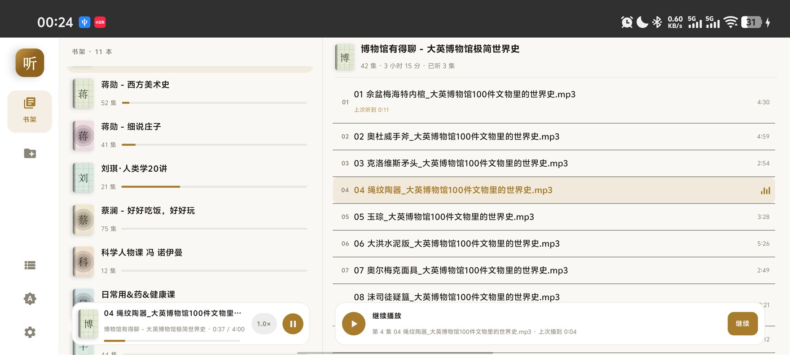
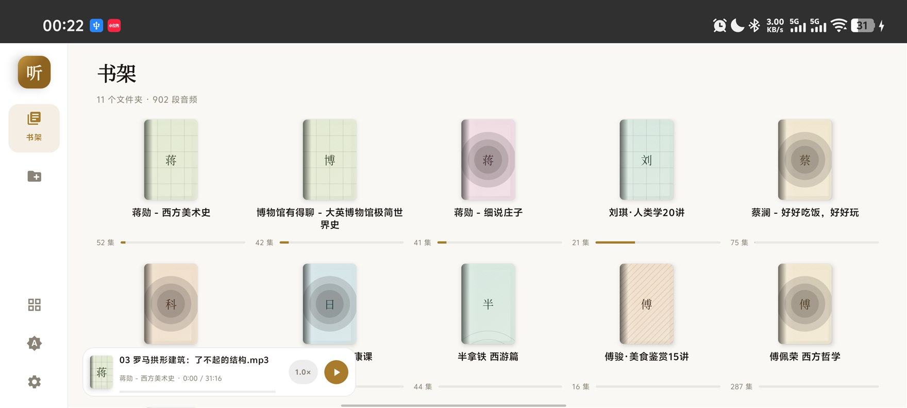
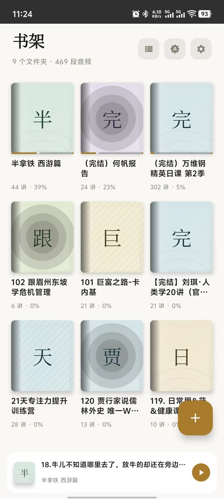
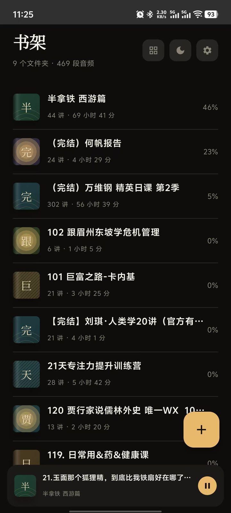
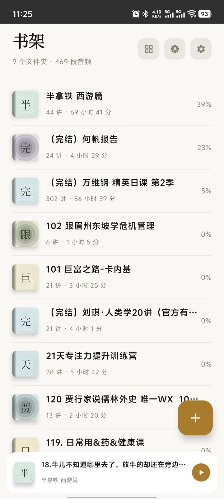
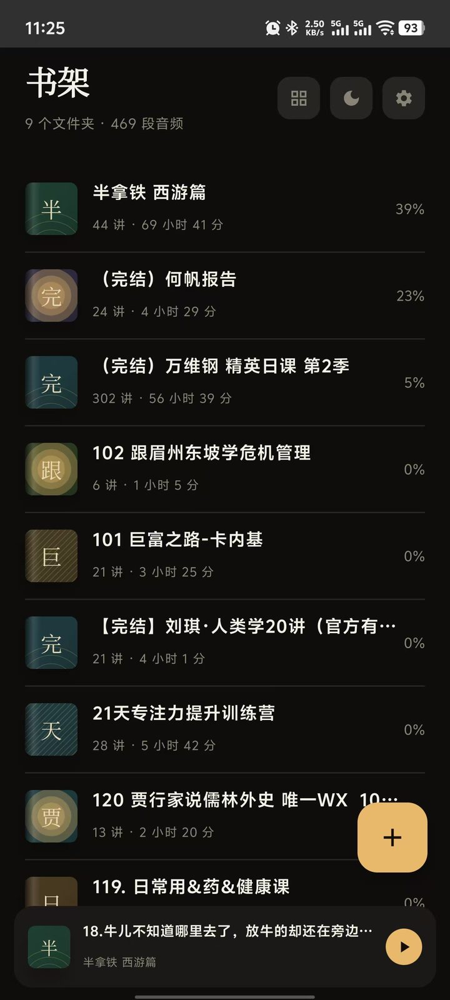
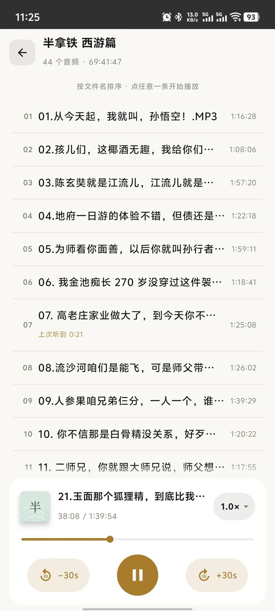
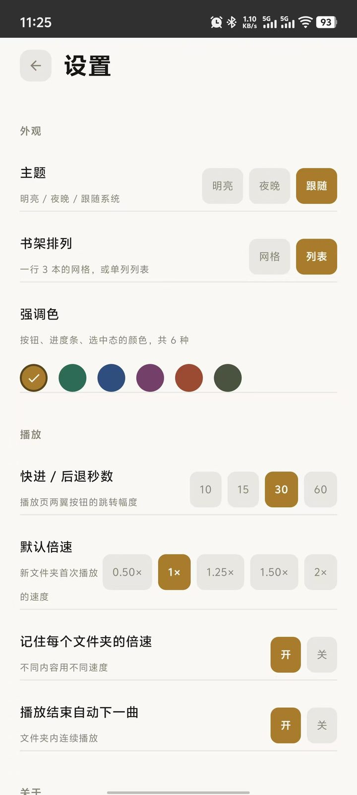
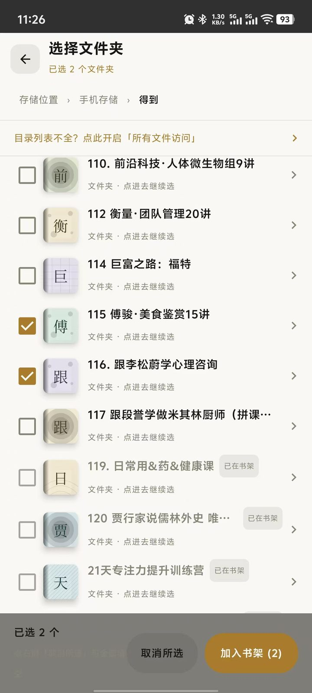
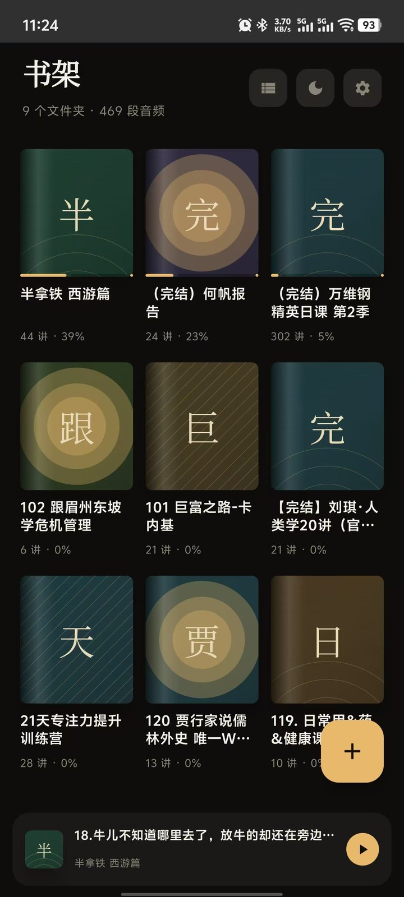

# 纯听书

纯本地 Android 听书播放器：不联网、不上传、无账号，直接读取手机存储里的音频文件夹即可听。

- **零网络权限**：清单里没有 `INTERNET`，数据不可能离开手机
- **文件夹即书**：把存音频的目录加入书架，同名目录就是一本书，子目录不会被误并进来
- **分课记进度**：每本书独立记录听到第几讲、每讲听到哪一秒，下次点开接着放
- **横屏 / 竖屏自适应**：手机竖屏、平板与车机横屏都有对应布局
- **明亮 / 夜晚 + 6 种强调色**，书架支持网格与列表两种排列
- 单 APK、无 native 库，任何 CPU 架构都能装；APK 约 2 MB

| 项 | 值 |
| --- | --- |
| 应用名 | 纯听书 |
| 包名 | `com.chunting.reader` |
| 当前版本 | 2.0.5（versionCode 20） |
| 技术栈 | Kotlin + Jetpack Compose + Media3(ExoPlayer) + Room + DataStore |
| 最低系统 | Android 6.0（API 23） |

## 界面预览

横屏（平板 / 车机）：左侧书架，右侧书籍详情与曲目，播放条常驻底部。

<p align="center">
  
  
</p>
<p align="center"><sub>横屏 · 列表排列 / 陈列排列</sub></p>

竖屏（手机）：

<p align="center">
  
  
  
  
  
  
</p>
<p align="center"><sub>书架（网格 / 列表，明亮 / 夜晚，含播放条）· 曲目列表 · 设置 · 选择文件夹</sub></p>

## 下载安装

1. 打开本仓库的 [Releases](../../releases) 页，下载最新一版 APK（文件名即版本号，如 `2.0.5.apk`）。
2. 手机上允许「安装未知来源应用」后直接安装。
3. 系统要求 **Android 6.0 及以上**（API 23）。APK 内不含 native 库，任何 CPU 架构都能装。
4. 后续版本可直接覆盖安装，书架、进度、设置都会保留。

> 与原「掌阅听书」包名不同，两者可共存，互不影响。

## 使用指南

### 1. 首次启动：授予存储权限

首次打开会申请**「音乐和音频」**权限，必须允许，否则书架和目录都是空的。

如果点进目录发现列表不全、看不到某些音频所在文件夹，去 **设置 → 目录列表不全？点此开启「所有文件访问」**，跳到系统页面把「所有文件访问权限」打开，再回到本应用即可。Android 11 以上的分区存储会限制子目录读取，这一步是根本解法。

### 2. 把文件夹加入书架

书架**不会自动导入**，由你手动挑：

1. 书架为空时点「添加文件夹」，进入「选择文件夹」页；
2. 从「内部存储」或「存储卡」逐层点进，找到存音频的那一层；
3. 点目录左侧方框多选，顶部会显示「已选 N 个文件夹」；若音频就在当前这一层，直接勾选上方的「当前文件夹」；
4. 点「加入书架」完成，返回书架即可看到入口。

一个书架条目对应磁盘上的一个文件夹，书名就是文件夹名，集名就是音频文件名（去掉扩展名，不读 ID3 标签）。

<p align="center"></p>
<p align="center"><sub>选择文件夹：逐层进入，左侧勾选可多选</sub></p>

### 3. 播放

- 书架标题行显示「N 个文件夹 · M 段音频」的总量；卡片副标题随排列方式变化：网格显示「44 讲 · 39%」这样的听书进度，列表显示「44 讲 · 69 小时 41 分」这样的总时长。
- 点开一本书进入曲目列表，顶部显示「N 个音频 · 总时长」，点任意一条开始播放；同一文件夹内会自动连播下一集。
- 底部播放条显示当前集序号与文件名，点它展开播放页，支持上一集/下一集、进度拖动、两侧按钮跳转（幅度在设置里调）。
- **倍速**：点一次速度按钮弹出候选菜单，选完即生效；开启「记住每个文件夹的倍速」后，各书可各自保持不同速度，新书用「默认倍速」。
- 播放期间会常驻通知栏，可锁屏收听。
- **横竖屏随系统**：手机竖屏为单栏布局；平板、车机等横屏设备为左右双栏，左侧书架、右侧书籍详情与曲目，信息密度更高。

<p align="center"></p>
<p align="center"><sub>曲目列表：底部播放条常驻，点任意一条开始播放</sub></p>

### 4. 进度与续播

每一集都独立记进度，长课程、多集节目可以分别续听：

- 曲目列表里非当前曲会显示「上次听到 mm:ss」；
- 进度以**实际播放落点**计算，回听前几集会回落，不会一直记「最远到达」；
- 播放中退出、切集、切后台都会立即落库。

### 5. 移除与删除

书架页长按/多选后可「从书架移除」：**只删除书架条目和对应的阅读进度，手机里的音频文件不会被删**。

### 6. 外观

书架页右上角三个入口依次是：**排列切换**（图标显示为「列表」或「网格」）、**主题切换**（月亮 / 太阳）、**设置**。

- 网格：一行 3 个文件夹，封面由文件夹名生成配色与衬线首字，卡片显示讲数与进度百分比；列表：单列，显示讲数与总时长，信息更密。
- 横屏下书架分为左右两栏：左栏在列表排列时为书架清单，右栏显示所选书籍的封面、讲数、总时长与曲目列表。
- 设置 → 主题：明亮 / 夜晚 / 跟随系统；强调色共 6 种，作用于按钮、进度条与选中态。
- 同一页还能调默认倍速、是否记住每个文件夹的倍速、播放结束是否自动下一曲、快进/后退秒数、播放页两侧按钮的跳转幅度。

<p align="center">
  
  
  
  
</p>
<p align="center"><sub>网格与列表，各配明亮 / 夜晚两套主题</sub></p>

<p align="center"></p>
<p align="center"><sub>设置页：主题、书架排列、强调色、倍速与按钮行为</sub></p>

## 常见问题

| 现象 | 原因与处理 |
| --- | --- |
| 提示「没有读到手机存储」 | 存储权限未授予，去系统设置给本应用开「音乐和音频」 |
| 目录里少了某些文件夹 | 分区存储限制，按上面第 1 节开启「所有文件访问」 |
| 某个音频文件不出现在列表里 | 该格式不在支持范围，见下方格式清单 |
| 添加了文件夹却提示「这个文件夹里没有音频文件」 | 该目录下确实没有受支持的音频，或音频都在更深一层的子目录里 |
| 书架为什么是空的 | 设计如此，书架不自动导入，需手动添加 |
| 横屏界面上书籍信息区是空的 | 先点左栏任一本书选中，右栏才会显示详情 |

**可正常播放的格式**：`mp3` `m4a` `m4b` `aac` `flac` `wav` `ogg` `oga` `opus` `amr` `awb` `3gp` `mp4`。

**目录里能列出、但点击无法播放**：`wma` `ape` `mid` `aif` `aiff`。本应用使用系统 Media3/ExoPlayer 解码，未集成这些格式的额外解码器，如需收听请先转码为 mp3 / m4a。

## 功能

| 模块 | 说明 |
| --- | --- |
| 文件夹浏览 | 按存储目录树逐层浏览，进入目录即读文件系统，不等系统媒体库扫描；子目录音频数后台异步探测 |
| 书架 | 把整个文件夹加入书架，显示集数、总时长与收听进度，支持网格/列表两种布局 |
| 横竖屏 | 竖屏单栏，横屏左右双栏（书架 + 书籍详情/曲目），适配手机、平板与车机 |
| 封面 | 不使用任何图片素材，由文件夹名哈希生成配色与衬线首字，故无 res 图片资源 |
| 播放 | 后台播放 + 通知栏控制，支持倍速（按文件夹记忆）、快进快退（秒数可设）、自动下一集、播放模式切换 |
| 分课进度 | 每一条音频独立记录进度，长课程/多集节目可分别续听 |
| 外观 | 深浅色/跟随系统，多套强调色可选 |
| 兼容性 | 最低 Android 6.0（API 23），可装在老车机等低版本设备上 |
| 隐私 | 纯本地运行，无网络权限依赖，音频与进度都只存在本机 |

## 目录结构

```
纯听书/
├─ app/                     应用模块（可直接用 Android Studio 打开本仓库）
│  ├─ build.gradle.kts      模块构建脚本（签名读 local.properties）
│  ├─ proguard-rules.pro    R8 混淆规则
│  └─ src/main/
│     ├─ AndroidManifest.xml
│     ├─ java/com/chunting/reader/
│     │  ├─ MainActivity.kt / TingApp.kt
│     │  ├─ data/           数据库(Room)、设置(DataStore)、扫描与目录树
│     │  ├─ player/         Media3 播放服务与控制
│     │  ├─ ui/             书架 / 文件夹 / 选择器 / 设置 / 主题 / 组件
│     │  └─ util/           格式化工具
│     └─ res/               图标与字符串资源
├─ docs/
│  └─ screenshots/          界面截图（用于本 README）
├─ release/                 已构建的安装包（本地存放，不入库）
├─ build.gradle.kts         根构建脚本（插件版本）
├─ settings.gradle.kts      工程名与模块声明
├─ gradle.properties        Gradle / AndroidX 配置
└─ local.properties         本机 SDK 路径与签名口令（不入库）
```

## 构建

前置：JDK 17、Android SDK（platform 36 + build-tools）。

1. 复制 `local.properties.example` 为 `local.properties`，填入自己的 `sdk.dir`；若要产出已签名 release 包，再填入签名四项。
2. 命令行构建（仓库自带 Gradle 8.13 wrapper，首次运行会自动下载发行包）：

```bat
gradlew.bat :app:assembleDebug
gradlew.bat :app:assembleRelease
```

macOS / Linux 用 `./gradlew`。也可直接用 Android Studio 打开本目录。

产物位于 `app/build/outputs/apk/`。

未配置签名时 release 会产出未签名包，可自行用 `apksigner` 签名。

## 签名与安全

- 签名口令写在 `local.properties`，该文件已被 `.gitignore` 排除，不会进入仓库。
- 密钥库文件（`*.keystore` / `*.jks`）同样不入库，请自行离线备份。
- 仓库内不包含 Android SDK、Gradle 发行包与构建产物。

## 版本记录

- **2.0.5** — 兼容更低的 Android 版本：最低支持 Android 6.0（API 23），老车机等低版本设备也能安装使用；新增横屏界面：平板、车机横屏下采用左右双栏布局，左侧书架、右侧书籍详情与曲目。
- **1.7.7** — 每集独立进度：跳听后回到原集可续播，曲目列表显示「上次听到 mm:ss」。
- **1.7.6** — 锁定竖屏，不做横屏适配。
- **1.5 → 1.7.5** — 曲目多选删除、删除当前书立即停止播放、进度按实际播放落点计算、明暗主题切换不再闪跳、播放条恢复圆角浮窗且点击不穿透、标题栏图标与标题整体居中。
- **1.0** — 首个可用版本：文件系统直读的目录浏览、手动书架、后台播放与通知栏控制。

## 许可

Apache License 2.0，见 [LICENSE](LICENSE)。
